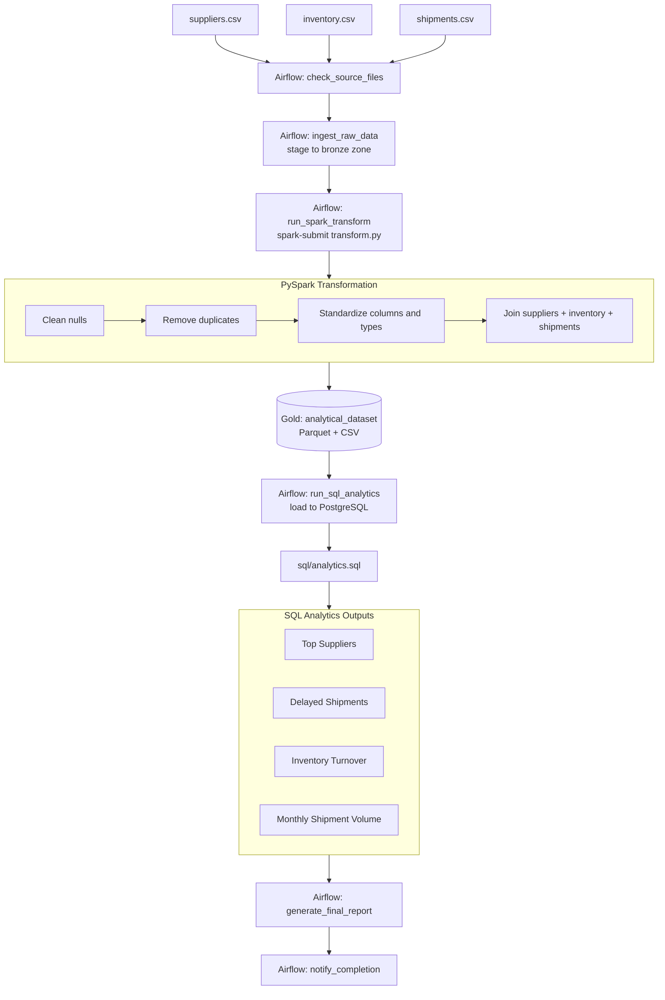

# Retail Supply Chain Data Pipeline

An end-to-end **batch data engineering pipeline** that ingests, cleans, joins,
and analyzes supplier, inventory, and shipment data for a retail supply
chain — built with **PySpark**, **Apache Airflow**, and **SQL**.

This is a beginner-to-intermediate portfolio project demonstrating core data
engineering skills: data modeling, batch ETL, workflow orchestration, data
quality handling, and SQL analytics.

---

## 1. Project Overview

Retail companies receive data from many suppliers, track thousands of SKUs
across warehouses, and manage continuous inbound/outbound shipments. This
project simulates that environment and builds a pipeline that:

1. **Ingests** raw CSV extracts for suppliers, inventory, and shipments.
2. **Cleans** the data — handling nulls, duplicates, and inconsistent formatting.
3. **Joins** the three datasets into a single analytics-ready fact table.
4. **Orchestrates** the whole process daily using Apache Airflow.
5. **Analyzes** the result with SQL — top suppliers, delayed shipments,
   inventory turnover, and monthly shipment volume.

```
suppliers.csv + inventory.csv + shipments.csv
        │
        ▼
   PySpark transform (clean → dedupe → standardize → join)
        │
        ▼
   analytical_dataset (Parquet / CSV)
        │
        ▼
   SQL analytics (top suppliers, delays, turnover, monthly volume)
```

---

## 2. Architecture Diagram



See [`architecture.md`](architecture.md) for a detailed component breakdown.

---

## 3. Folder Structure

```
retail-supply-chain-pipeline/
│
├── airflow/
│   ├── retail_pipeline_dag.py     # Airflow DAG definition
│   └── run_sql_analytics.py       # Helper: loads Gold data to Postgres + runs analytics.sql
│
├── datasets/
│   ├── suppliers.csv              # 100 rows
│   ├── inventory.csv              # 1,000 rows
│   └── shipments.csv              # 2,000 rows
│
├── pyspark/
│   └── transform.py               # Clean, dedupe, standardize, join -> analytical dataset
│
├── sql/
│   └── analytics.sql              # Top suppliers / delays / turnover / monthly volume
│
├── screenshots/                   # Place Airflow UI / Spark run screenshots here
│
├── requirements.txt
├── architecture.md
└── README.md
```

---

## 4. Tech Stack

| Layer            | Technology                          |
|-------------------|----------------------------------------|
| Orchestration       | Apache Airflow 2.9                       |
| Transformation        | PySpark 3.5 (Spark SQL + DataFrame API)    |
| Storage formats          | CSV (raw), Parquet + CSV (analytical dataset) |
| Analytics database          | PostgreSQL (optional; Spark SQL / DuckDB also work) |
| Language                       | Python 3.10+                                  |
| Data generation                   | Python `random` / `csv` (seeded, deterministic) |

---

## 5. Installation & Setup

### 5.1 Prerequisites
- Python 3.10+
- Java 11+ (required by PySpark)
- (Optional) PostgreSQL 13+ for the SQL analytics layer

### 5.2 Clone & install dependencies

```bash
git clone <your-repo-url> retail-supply-chain-pipeline
cd retail-supply-chain-pipeline
python3 -m venv venv
source venv/bin/activate        # Windows: venv\Scripts\activate
pip install -r requirements.txt
```

### 5.3 Run the PySpark transformation standalone

```bash
cd pyspark
python3 transform.py --input-dir ../datasets --output-dir ../output
# or, using a real Spark cluster/binary:
spark-submit transform.py --input-dir ../datasets --output-dir ../output
```

This produces:
- `output/analytical_dataset_parquet/`
- `output/analytical_dataset_csv/`

### 5.4 Run the SQL analytics (optional, requires PostgreSQL)

```bash
createdb retail_pipeline
export PG_HOST=localhost PG_PORT=5432 PG_DATABASE=retail_pipeline PG_USER=postgres PG_PASSWORD=postgres

python3 airflow/run_sql_analytics.py \
    --output-dir ../output \
    --sql-file ../sql/analytics.sql \
    --table analytical_dataset
```

Results are written to `output/analytics_results/*.csv`.

> **Running without PostgreSQL:** load `output/analytical_dataset_csv/*.csv`
> into DuckDB or Spark SQL instead, then run the same queries from
> `sql/analytics.sql` (the syntax is ANSI-SQL compatible).

### 5.5 Run the full pipeline with Airflow

```bash
export AIRFLOW_HOME=~/airflow
export RETAIL_PIPELINE_ROOT=$(pwd)

airflow db init
airflow users create \
    --username admin --password admin \
    --firstname Admin --lastname User \
    --role Admin --email admin@example.com

mkdir -p $AIRFLOW_HOME/dags
cp airflow/retail_pipeline_dag.py $AIRFLOW_HOME/dags/
cp airflow/run_sql_analytics.py $AIRFLOW_HOME/dags/   # or keep path in RETAIL_PIPELINE_ROOT

airflow standalone
```

Open the Airflow UI at `http://localhost:8080`, enable the
`retail_supply_chain_pipeline` DAG, and trigger a run. Add screenshots of
the DAG graph / task logs to the `screenshots/` folder.

---

## 6. Sample Outputs

### 6.1 Final analytical dataset (excerpt)

| shipment_id | supplier_name           | product_name        | total_shipment_value | status     | is_delayed |
|-------------|---------------------------|------------------------|------------------------:|------------|------------|
| SHP000005   | Pacific Logistics Group   | Football #686            | 231,936.64               | IN_TRANSIT | false      |
| SHP000036   | United Manufacturing Corp | Vitamin C Serum #782       | 7,137.70                   | DELIVERED  | true       |
| SHP000045   | Global Manufacturing Corp | Air Fryer #947                | 653,902.32                    | DELIVERED  | false      |

### 6.2 Top Suppliers

| supplier_id | supplier_name             | country | avg_rating | total_shipments | total_shipment_value |
|-------------|-----------------------------|---------|-----------:|-----------------:|------------------------:|
| SUP0040     | Horizon Goods Network          | India   | 4.8        | 37                | 15,427,120.76             |
| SUP0093     | National Wholesale Partners       | Brazil  | 4.2        | 27                | 11,032,978.11                |
| SUP0007     | Apex Manufacturing Corp              | USA     | 4.7        | 29                | 10,948,052.86                   |

### 6.3 Delayed Shipments (sample)

| shipment_id | supplier_name        | product_name           | delay_days | status  |
|-------------|------------------------|---------------------------|-----------:|---------|
| SHP001337   | Nova Supplies Co          | Basmati Rice 5kg #828         | 10         | DELAYED |
| SHP001818   | Apex Industries Inc          | Plush Bear #978                    | 10         | DELAYED |
| SHP000919   | Global Logistics Group          | Cricket Bat #439                       | 10         | DELAYED |

### 6.4 Monthly Shipment Volume (sample)

| shipment_year | shipment_month | total_shipments | total_units | total_value   |
|---------------|-----------------|------------------:|--------------:|----------------:|
| 2024          | 1               | 95                 | 47,019          | 29,510,210.61    |
| 2024          | 2               | 71                 | 34,038            | 23,278,429.57       |
| 2024          | 3               | 82                 | 40,855               | 21,370,797.21          |

> Numbers above were generated from the included synthetic datasets and will
> vary slightly each time `gen_data.py`-style generation is re-run with a
> different seed.

---

## 7. Data Quality Handled by the Pipeline

The raw CSVs intentionally contain realistic messiness, all handled in
`pyspark/transform.py`:
- Missing values (empty `rating`, `unit_price`, `shipping_cost`, etc.) → filled with sensible defaults
- Duplicate rows (~1% of each file) → removed via `dropDuplicates` on primary keys
- Inconsistent casing/whitespace in names → trimmed and standardized
- Shipments with no `actual_delivery_date` (still in transit/cancelled) → `delay_days` left null instead of defaulting to 0

---

## 8. Future Improvements

- [ ] Replace local CSVs with cloud object storage (S3 / Azure Data Lake / GCS) as the raw landing zone
- [ ] Move Spark execution to a managed cluster (EMR, Databricks, or Dataproc) for larger volumes
- [ ] Add data quality testing with **Great Expectations** or **dbt tests**
- [ ] Add **dbt** for SQL transformation/version control instead of raw `.sql` scripts
- [ ] Incremental/CDC ingestion instead of full daily reloads
- [ ] Add a BI layer (Metabase / Looker Studio / Power BI) on top of the analytical dataset
- [ ] Add CI/CD (GitHub Actions) to test the Spark job and DAG on every commit
- [ ] Add Airflow SLAs, alerting (Slack/email), and data lineage (OpenLineage)
- [ ] Containerize the whole stack with Docker Compose (Airflow + Spark + Postgres)
- [ ] Add unit tests for `transform.py` using `pytest` + `chispa`/`pyspark.testing`

---

## 9. License

This is a learning/portfolio project. Feel free to fork, modify, and reuse.
