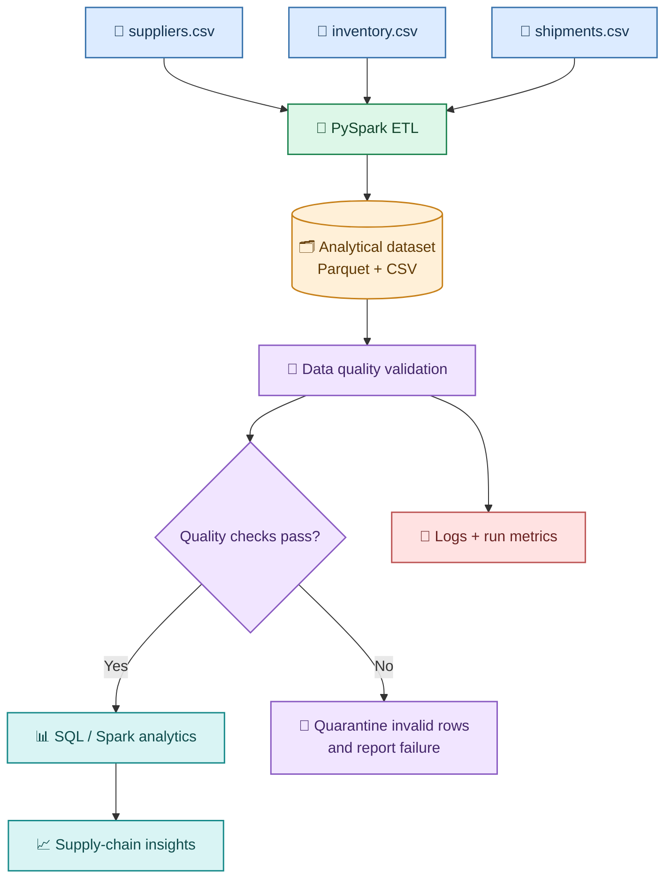
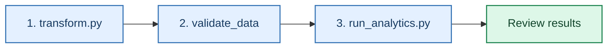

<div align="center">

# 🛒 Retail Supply Chain Data Pipeline

### A local-first batch data engineering project built with Python, PySpark, and SQL

<p>
  
  
  
  
</p>

**Ingest → Transform → Validate → Analyze**

A portfolio project that transforms supplier, inventory, and shipment CSV files into an analytics-ready dataset and checks data quality before downstream analysis.

</div>

---

## 📌 Table of contents

- [Project overview](#-project-overview)
- [Architecture](#-architecture)
- [Technology stack](#-technology-stack)
- [Repository structure](#-repository-structure)
- [Data sources](#-data-sources)
- [Getting started on Windows](#-getting-started-on-windows)
- [Run the pipeline](#-run-the-pipeline)
- [Data quality rules](#-data-quality-rules)
- [Metrics and logging](#-metrics-and-logging)
- [SQL analytics](#-sql-analytics)
- [Output data](#-output-data)
- [Troubleshooting](#-troubleshooting)
- [Roadmap](#-roadmap)
- [Attribution and license](#-attribution-and-license)

## 🎯 Project overview

Retail supply chains rely on accurate supplier, inventory, and shipment information. This project simulates a batch pipeline that brings these datasets together so they can be inspected and analyzed.

### What the project does

- **Ingests** supplier, inventory, and shipment data from CSV files.
- **Transforms** and combines data using PySpark.
- **Stores** analytical output in Parquet and CSV formats.
- **Validates** important data quality rules before analysis.
- **Quarantines** invalid records when the validation rules identify them.
- **Logs** validation results to the console and a local log file.
- **Analyzes** supply-chain trends with SQL/Spark-based analytics.
- **Records metrics** such as record counts, validation status, and duration.

> **Execution note:** The core workflow is designed to run locally. Airflow-related files are present in the repository, but Airflow orchestration is optional and is not required for the local commands below.

## 🧭 Architecture

The core local workflow is:



### Pipeline stages

| Stage | Purpose | Main location |
|---|---|---|
| Source data | Holds the input CSV files | `datasets/` |
| ETL | Cleans, transforms, and joins data | `pyspark/transform.py` |
| Analytical storage | Writes Parquet and CSV datasets | `output/` |
| Data quality | Checks required IDs, negative values, and duplicates | `data_quality/validate_data.py` |
| Logging | Captures pipeline and validation messages | `utils/logger.py`, `logs/` |
| Metrics | Stores the latest validation run summary | `pipeline_metrics/` |
| Analytics | Runs supply-chain analysis | `sql/` |

## 🧰 Technology stack

| Technology | How it is used |
|---|---|
| Python | Pipeline scripts, logging, metrics |
| PySpark | Distributed-style DataFrame transformations running locally |
| Spark SQL / SQL | Analytical queries and aggregations |
| CSV | Source data format |
| Parquet | Columnar analytical output format |
| Git and GitHub | Version control and portfolio sharing |
| Apache Airflow | Optional orchestration path; not required for the local workflow |

## 🗂️ Repository structure

```text
retail-supply-chain-pipeline/
│
├── datasets/
│   ├── suppliers.csv
│   ├── inventory.csv
│   └── shipments.csv
│
├── pyspark/
│   └── transform.py
│
├── data_quality/
│   └── validate_data.py
│
├── sql/
│   ├── analytics.sql
│   └── run_analytics.py
│
├── utils/
│   ├── __init__.py
│   └── logger.py
│
├── pipeline_metrics/
│   └── record_metrics.py
│
├── airflow/                 # Optional orchestration-related files
├── screenshots/              # Add project screenshots here
├── config.py
├── architecture.md
├── requirements.txt
├── .gitignore
└── README.md
```

Generated folders such as `output/`, `logs/`, and the virtual environment are created locally and should not be committed.

> If you add `run_pipeline.py` and automated tests as part of your next improvements, include them in this structure after verifying that the files exist and the commands pass.

## 📦 Data sources

The project uses three input CSV datasets:

| File | Purpose |
|---|---|
| `suppliers.csv` | Supplier attributes and related information |
| `inventory.csv` | Product and inventory information |
| `shipments.csv` | Shipment details, quantities, dates, and values |

The repository's sample data is intended for learning and portfolio demonstration. Review the CSV headers and the transformation code to confirm exact schemas and row counts for your local copy.

## 🪟 Getting started on Windows

### Prerequisites

- Python 3.10 or later (the current development environment uses Python 3.12)
- Java installed and configured for your PySpark version
- Git
- Visual Studio Code or another editor

### 1. Clone the repository

Replace the URL below with your own fork URL if you are publishing a personal copy.

```powershell
git clone https://github.com/Atharva-512/retail-supply-chain-pipeline.git
cd retail-supply-chain-pipeline
```

### 2. Create and activate a virtual environment

```powershell
python -m venv venv
.\venv\Scripts\Activate.ps1
```

If PowerShell blocks activation, you can invoke the environment's Python directly:

```powershell
.\venv\Scripts\python.exe --version
```

### 3. Install dependencies

```powershell
python -m pip install --upgrade pip
pip install -r requirements.txt
```

### 4. Check Python and Java

```powershell
python --version
java -version
```

PySpark requires a compatible Java installation. If Spark reports a Java-related error, verify `JAVA_HOME` and that `java` is available in `PATH`.

## ▶️ Run the pipeline

Run these commands from the **repository root** in PowerShell, with the virtual environment activated.

### Step 1 — Run PySpark ETL

```powershell
python .\pyspark\transform.py --input-dir .\datasets --output-dir .\output
```

Expected output locations:

- `output/analytical_dataset_parquet/`
- `output/analytical_dataset_csv/`

### Step 2 — Run data quality validation

Use module execution so Python can resolve the project-root `utils` package:

```powershell
python -m data_quality.validate_data
```

The validation script reads the Parquet dataset produced by the ETL stage. It logs record counts and validation status, and writes invalid rows to `output/quarantine/` when invalid rows are found.

### Step 3 — Run SQL analytics

```powershell
python .\sql\run_analytics.py
```

The analytics script reads the generated analytical dataset. Review its console output for supplier, shipment, delay, inventory, and monthly summaries implemented in the script.

### Run order at a glance



> **Optional pipeline runner:** If you create and test a root-level `run_pipeline.py`, you can expose the full sequence through `python .\run_pipeline.py`. Do not use that command until the runner file exists and has been tested in your environment.

## ✅ Data quality rules

The current validation script checks the following rules:

| Rule | What it checks |
|---|---|
| Required shipment ID | `shipment_id` must not be null |
| Required product ID | `product_id` must not be null |
| Non-negative quantity | `quantity_shipped` must not be negative |
| Non-negative shipment value | `total_shipment_value` must not be negative |
| Unique shipment ID | Detects shipment IDs that occur more than once |

### Validation behavior

- Total, valid, and invalid record counts are logged.
- Duplicate shipment ID counts are logged.
- Invalid rows are written to `output/quarantine/` when invalid rows are detected.
- The script reports failure if invalid rows or duplicate shipment IDs are detected.
- A passing run is logged as `DATA QUALITY STATUS: PASSED`.

**Scope note:** The current duplicate check reports duplicate shipment IDs; it does not automatically remove those duplicates from the analytical dataset. Nulls in columns other than the explicitly checked IDs, and other business-specific rules, require additional checks if they are needed.

## 📈 Metrics and logging

The logging utility is in `utils/logger.py`. Log output is written to the console and, when configured as in the current project, to:

```text
logs/pipeline.log
```

The metrics helper is:

```text
pipeline_metrics/record_metrics.py
```

It writes the latest metrics to:

```text
pipeline_metrics/latest_run.json
```

Metrics include:

- UTC run timestamp
- Total record count
- Valid record count
- Invalid record count
- Duplicate shipment ID count
- Run status
- Duration in seconds

Run the metrics helper's standalone smoke test with:

```powershell
python -m pipeline_metrics.record_metrics
```

This standalone command writes **sample values**. For actual validation results, run the data quality module after the metrics helper has been integrated with it.

## 📊 SQL analytics

The SQL and analytics files are:

- `sql/analytics.sql` — SQL query definitions
- `sql/run_analytics.py` — local analytics runner

Depending on the implemented queries, the project can help investigate questions such as:

- Which suppliers contribute the greatest shipment value?
- How many shipments are delayed?
- What is the average delivery delay?
- Which products have low inventory?
- How does shipment volume vary by month?
- How are shipments distributed by status?

Refer to `sql/analytics.sql` and the output of `run_analytics.py` for the exact query logic and fields currently implemented.

## 🧾 Output data

After a successful ETL run, the principal outputs are:

```text
output/
├── analytical_dataset_parquet/
└── analytical_dataset_csv/
```

If validation finds invalid rows, it may also create:

```text
output/
└── quarantine/
```

These are generated artifacts. They are excluded from version control so that the repository remains lightweight and reproducible.

## 🛠️ Troubleshooting

### `ModuleNotFoundError: No module named 'utils'`

Run the validation script as a module from the repository root:

```powershell
python -m data_quality.validate_data
```

Check that these files exist:

```text
utils/
├── __init__.py
└── logger.py
```

### Spark or Java startup errors

Check:

```powershell
python --version
java -version
```

Ensure the installed Java version is compatible with your PySpark version and configured in `PATH`/`JAVA_HOME`.

### Analytics says the Parquet output does not exist

Run ETL first:

```powershell
python .\pyspark\transform.py --input-dir .\datasets --output-dir .\output
```

Then run validation and analytics.

### Generated files appear in Git status

Review `.gitignore` and check whether the files were already tracked. Ignore rules do not automatically remove previously tracked files from Git.

## 🗺️ Roadmap

- [x] Local PySpark ETL workflow
- [x] Parquet and CSV analytical outputs
- [x] Data quality validation and invalid-row quarantine
- [x] Logging utility
- [x] Metrics helper for run summaries
- [ ] Add tests for validation rules and transformations
- [ ] Complete and test a single-command pipeline runner
- [ ] Add representative failure-case test data
- [ ] Add documented sample outputs and screenshots
- [ ] Consider Airflow orchestration after the local pipeline is stable
- [ ] Add CI checks with GitHub Actions

## 📜 Attribution and license

This repository is based on the original project:

**Original repository:** [Atharva-512/retail-supply-chain-pipeline](https://github.com/Atharva-512/retail-supply-chain-pipeline)

Retain the original license and attribution notices required by that repository. Describe personal modifications clearly and do not imply that the original project was authored entirely from scratch.

Before redistributing, confirm the license terms in the repository's license file. If no license file is present, do not assume that the code is unrestricted for reuse.

---

<div align="center">

**Built as a hands-on Data Engineering portfolio project**

*Local-first • Reproducible • Focused on practical ETL and data quality*

</div>
